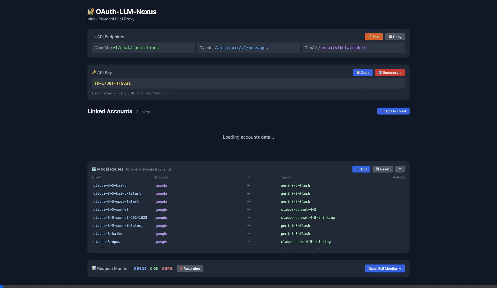
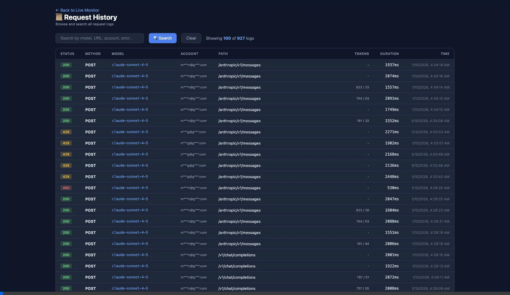
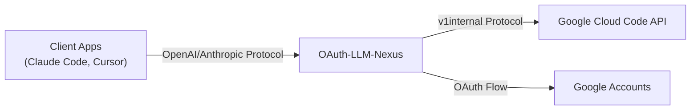

# OAuth-LLM-Nexus

[](https://github.com/pysugar/oauth-llm-nexus/releases)
[](https://go.dev)
[](LICENSE)

**OAuth-LLM-Nexus** is a powerful, lightweight proxy server that bridges standard LLM clients (OpenAI, Anthropic, Google GenAI) with Google's internal "Cloud Code" API (Gemini). It allows you to use your Google account's free tier quotas to power your favorite AI tools like Claude Code, Cursor, generic OpenAI clients, and more.

## ✨ Features

-   **Multi-Protocol Support**:
    -   **OpenAI Compatible**: `/v1/chat/completions`, `/v1/responses` (Works with Cursor, Open WebUI, etc.)
    -   **Anthropic Compatible**: `/anthropic/v1/messages`, `/v1/messages` (Works with Claude Code, Aider, etc.)
    -   **Google GenAI Compatible**: `/genai/v1beta/models` (Works with official Google SDKs)
    -   **Gemini API Unified / Transparent Proxy**: `/v1beta/models/*` (Works natively or translated across any backend)
    -   **Vertex AI Transparent Proxy**: `/v1/publishers/google/models/*` (server-side Vertex key injection)
    -   **Codex Adapter (provider=codex)**: OpenAI-facing `/v1/chat/completions` and `/v1/responses` with stream-first behavior
-   **Multi-Backend API Aggregation & Runtime Switching**: Aggregate **OpenAI**, **OpenRouter**, **NVIDIA NIM**, **AMD Radeon Token Factory**, **Ollama**, **DeepSeek API**, and **Google Gemini API** behind any of the 4 client protocols (`config/providers.yaml`), with sticky multi-key rotation, adaptive cooldown, ordered failover or pinned policy, and instant Dashboard / API backend switching (`docs/design_proposals/api-aggregation-gateway.md`).
-   **Smart Model Mapping**: Configurable routing from client model names to backend models via Dashboard.
-   **Account Pool Management**: Link multiple Google accounts to pool quotas and increase limits.
-   **User-Specific Quota Routing**: Route requests to specific accounts using `X-Nexus-Account` header for quota isolation.
-   **Automatic Failover**: Automatically switches to the next available account if one hits a rate limit (429).
-   **Dashboard**: A built-in web dashboard to manage accounts, model routes, view usage, and get your API key.
-   **Request Monitor**: Real-time request monitoring with detailed logs, latency tracking, and error analysis.
-   **Secure**: API Key authentication for client access.
-   **Homebrew Support**: Easy installation via `brew tap` with service management.

📚 **Quick Start Guide**: [Claude Code Setup](docs/CLAUDE_CODE_SETUP.md) | [English README](README.md) | [中文文档](README_CN.md)
  
📌 **OpenClaw Integration SOP**: [docs/openclaw-integration-sop.md](docs/openclaw-integration-sop.md)

## 🖼️ Preview

### Dashboard Overview
**Account Management, API Key (masked), and Model Routes**


### Monitor Overview
**Real-time Request History with Privacy Masking**


> **🔒 Privacy**: All sensitive information (emails and API keys) are **masked by default**. Hover to reveal full content when needed.

## 🚀 Installation

### Option 1: Homebrew (macOS/Linux)

```bash
# Add tap
brew tap pysugar/tap

# Install
brew install oauth-llm-nexus

# Start as service
brew services start oauth-llm-nexus
```

### Option 2: Download Binary

Download the latest release for your platform from [Releases](https://github.com/pysugar/oauth-llm-nexus/releases).

```bash
# macOS Apple Silicon
curl -LO https://github.com/pysugar/oauth-llm-nexus/releases/latest/download/nexus-darwin-arm64
chmod +x nexus-darwin-arm64
./nexus-darwin-arm64
```

### Option 3: Docker

```bash
# Pull from GitHub Container Registry
docker pull ghcr.io/pysugar/oauth-llm-nexus:latest

# Run with Docker (create directory first for proper permissions)
mkdir -p ~/.oauth-llm-nexus
docker run -d \
  --name oauth-llm-nexus \
  -p 8086:8080 \
  -v ~/.oauth-llm-nexus:/home/nexus \
  ghcr.io/pysugar/oauth-llm-nexus:latest

# Or use Docker Compose
curl -O https://raw.githubusercontent.com/pysugar/oauth-llm-nexus/main/docker-compose.yml
docker-compose up -d
```

### Option 4: Build from Source

```bash
git clone https://github.com/pysugar/oauth-llm-nexus.git
cd oauth-llm-nexus

# Build with Make (automatically injects version)
make build

# Or manual build
# go build -ldflags "-X github.com/pysugar/oauth-llm-nexus/internal/version.Version=dev" -o nexus ./cmd/nexus

./nexus
```

## ⚙️ Quick Start

Just run the binary - no configuration needed for most users:

```bash
./nexus
```

The server will start on `127.0.0.1:8080` by default (or `:8086` in release mode). Visit `http://localhost:8080` (or `http://localhost:8086`) to access the dashboard.

### Environment Variables

| Variable | Default | Description |
|:---------|:--------|:------------|
| `PORT` | `8080` (dev) / `8086` (release) | Server port |
| `HOST` | `127.0.0.1` | Bind address. Set to `0.0.0.0` for LAN access |
| `NEXUS_MODE` | - | Set to `release` for production (changes default port to 8086) |
| `NEXUS_ADMIN_PASSWORD` | - | Optional password to protect Dashboard and API endpoints |
| `NEXUS_VERBOSE` | - | Set to `1` or `true` to enable detailed request/response logging |
| `NEXUS_ANTIGRAVITY_USER_AGENT` | `antigravity/1.15.8 windows/amd64` | Override upstream Antigravity user agent |
| `NEXUS_VERTEX_API_KEY` | - | Enable Vertex transparent proxy (`/v1/publishers/google/models/*`) |
| `NEXUS_VERTEX_BASE_URL` | `https://aiplatform.googleapis.com` | Vertex upstream base URL override |
| `NEXUS_VERTEX_PROXY_TIMEOUT` | `5m` | Upstream timeout for Vertex compatibility proxy |
| `NEXUS_GEMINI_API_KEYS` | - | Comma-separated multi-key list for Gemini API proxy with 429-triggered auto-switching |
| `NEXUS_GEMINI_API_KEY` | - | Single key for Gemini API transparent proxy (`/v1beta/models/*`) |
| `GEMINI_API_KEY` | - | Fallback key for Gemini API transparent proxy when neither `NEXUS_GEMINI_API_KEYS` nor `NEXUS_GEMINI_API_KEY` is set |
| `NEXUS_GEMINI_BASE_URL` | `https://generativelanguage.googleapis.com` | Gemini API upstream base URL override |
| `NEXUS_GEMINI_PROXY_TIMEOUT` | `5m` | Upstream timeout for Gemini API transparent proxy |

**Example: LAN Access with Password Protection**
```bash
export HOST=0.0.0.0
export PORT=8086
export NEXUS_ADMIN_PASSWORD=mysecret
./nexus
# Now accessible from other devices with password protection
```

**Example: Enable Verbose Logging for Debugging**
```bash
NEXUS_VERBOSE=1 ./nexus
# Logs will include full request bodies and API responses
```

### Protocol Compatibility Notes

-   **Codex is stream-first by design**: for `provider=codex`, streaming is the primary compatibility target.
-   **Codex `/v1/responses` behavior**: upstream is responses-stream based; clients should enable streaming. In current implementation, codex responses may still return SSE even when `stream=false`.
-   **Codex parameter filtering**: unsupported parameters (for example `temperature`, `top_p`, `max_output_tokens`) are filtered before upstream forwarding to avoid upstream 4xx errors.
-   **Filtering transparency**: filtered keys are exposed via `X-Nexus-Codex-Filtered-Params` response header.
-   **Codex filtering header semantics**: `X-Nexus-Codex-Filtered-Params` is present only when filtering actually happens; otherwise this header is omitted.
-   **Responses compatibility marker**: `X-Nexus-Responses-Compat: request_id_smuggled` indicates that `conversation` / `previous_response_id` were encoded into upstream `requestId` and restored in the final response.
-   **Responses non-2xx mapping**: `/v1/responses` normalizes upstream non-2xx responses into OpenAI-style envelopes (`error.message/type/code`) for both non-stream and stream preflight paths.
-   **Gemini-3 web search**: for Google antigravity upstream, Gemini-3 family search is treated as unsupported by design (see `docs/gemini-search-support.md`).

#### Responses Compatibility Header Matrix

| Endpoint | Trigger | Response Header | Meaning |
| --- | --- | --- | --- |
| `/v1/responses` | Request includes `conversation` and/or `previous_response_id`, and requestId smuggling succeeds | `X-Nexus-Responses-Compat: request_id_smuggled` | Compatibility fields were transported via upstream `requestId` and restored to OpenAI-compatible response fields |
| `/v1/responses` | No compatibility fields, or smuggling not required | _(header omitted)_ | No compatibility smuggling path used |

### 🔐 Dashboard Security

When `NEXUS_ADMIN_PASSWORD` is set, the Dashboard and `/api/*` endpoints are protected by HTTP Basic Authentication:

- **Username**: Any value (e.g., `admin`, your email, or leave empty)
- **Password**: The value of `NEXUS_ADMIN_PASSWORD`

If not set, the Dashboard is accessible without authentication (default for local development).

### 💡 Headless/Docker Deployment

> **⚠️ OAuth Limitation**: Google's OAuth for Antigravity only allows `localhost` callbacks. This means OAuth login must be completed on the machine running nexus. This is a security feature of the Antigravity OAuth client, not a bug.

**For remote servers or Docker containers:**

1. **Complete OAuth locally first**:
   ```bash
   # On your local machine with a browser
   ./nexus
   # Visit http://localhost:8086, complete OAuth login
   ```

2. **Copy the database to the server**:
   ```bash
   # The database contains your authenticated sessions
   scp nexus.db user@your-server:/path/to/nexus/
   
   # For Docker: create directory first with correct permissions
   mkdir -p ~/.oauth-llm-nexus
   cp nexus.db ~/.oauth-llm-nexus/
   # If using sudo/docker created it as root, fix permissions:
   # sudo chown -R $(id -u):$(id -g) ~/.oauth-llm-nexus/
   ```

3. **Start nexus on the server**:
   ```bash
   # Native
   HOST=0.0.0.0 NEXUS_ADMIN_PASSWORD=yourpassword ./nexus
   
   # Docker (database is already in ~/.oauth-llm-nexus/)
   docker-compose up -d
   ```

Your authenticated sessions will be picked up automatically. Token refresh happens in the background.

## 📖 Usage

### 1. Open the Dashboard

Visit `http://localhost:8086` in your browser.

### 2. Link Account

Click "Add Account" and sign in with your Google account (must have access to Gemini/Cloud Code).

### 3. Get API Key

Copy your API Key from the dashboard (`sk-xxxxxxxx...`).

### 4. Configure Clients

**OpenAI SDK / Compatible Apps (Cursor, Continue, etc.)**:
```
Base URL: http://localhost:8086/v1
API Key: sk-xxxxxxxx...
Model: gpt-4o, gpt-4, or gemini-2.5-pro
```

**Anthropic / Claude Code**:
```bash
export ANTHROPIC_BASE_URL=http://localhost:8086/anthropic
export ANTHROPIC_API_KEY=sk-xxxxxxxx...
# Model: claude-sonnet-4-5, claude-3-5-sonnet, etc.
```

**Google GenAI SDK (v0.2+)**:
```python
from google import genai

client = genai.Client(
    api_key="sk-xxx",
    http_options={"base_url": "http://localhost:8086/genai"}
)

response = client.models.generate_content(
    model="gemini-3-flash", 
    contents="Hello world"
)
print(response.text)
```

**OpenClaw (google provider via Nexus proxy)**:
```bash
# In OpenClaw runtime env:
# GEMINI_API_KEY must be Nexus API key (sk-...), not real upstream Gemini/Vertex key
export GEMINI_API_KEY="sk-your-nexus-key"

# In OpenClaw config:
# models.providers.google.baseUrl = "http://127.0.0.1:8080"
```

See full SOP: [docs/openclaw-integration-sop.md](docs/openclaw-integration-sop.md)

## 🗺️ Model Mapping

OAuth-LLM-Nexus supports configurable model routing. Configure mappings via the Dashboard or edit `config/model_routes.yaml`:

```yaml
routes:
  - client: gpt-4o
    provider: google
    target: gemini-3-pro-high
  - client: claude-sonnet-4-5
    provider: google
    target: claude-sonnet-4-5
```

Models not in the routing table are passed through as-is (e.g., native Gemini models).

## 🎯 User-Specific Quota Routing

By default, all requests use the **Primary** account's quota. You can route specific requests to different accounts using the `X-Nexus-Account` header:

```bash
# Route to a specific account by email
curl -X POST http://localhost:8086/v1/chat/completions \
  -H "Authorization: Bearer sk-xxx" \
  -H "X-Nexus-Account: user@example.com" \
  -H "Content-Type: application/json" \
  -d '{"model": "gpt-4o", "messages": [{"role": "user", "content": "Hello"}]}'
```

**Use Cases**:
- **Team Quota Isolation**: Assign different team members to different accounts
- **Project-Based Routing**: Use separate accounts for different projects  
- **Rate Limit Management**: Distribute high-volume workloads across multiple accounts

| Header | Value | Description |
|:-------|:------|:------------|
| `X-Nexus-Account` | Email or Account ID | Routes to specified account instead of Primary |

> **Note**: The specified account must be linked in the Dashboard and active. If not found, the request returns 401 Unauthorized.

## 🛠️ Tools

### Quick Quota Check

Check real-time quota for your **locally logged-in Antigravity account** (not the accounts linked in Nexus):

```bash
# Install dependency
pip install requests

# Run quota check
python3 scripts/antigravity_quota.py

# Output formats
python3 scripts/antigravity_quota.py --json    # JSON output
python3 scripts/antigravity_quota.py --raw     # Raw API response
```

This script reads credentials from your local Antigravity installation and shows accurate quota percentages for all available models.

## 🏗️ Architecture



## 🍺 Homebrew Service

If installed via Homebrew:

```bash
# Start service (runs on boot)
brew services start oauth-llm-nexus

# Stop service
brew services stop oauth-llm-nexus

# View logs
tail -f /opt/homebrew/var/log/oauth-llm-nexus.log
```

**Customize environment variables**: Edit `$(brew --prefix)/etc/oauth-llm-nexus.env`:

```bash
# Create/edit the environment file
echo 'export NEXUS_VERBOSE="true"' >> $(brew --prefix)/etc/oauth-llm-nexus.env
echo 'export NEXUS_ADMIN_PASSWORD="yourpassword"' >> $(brew --prefix)/etc/oauth-llm-nexus.env

# Restart service to apply
brew services restart oauth-llm-nexus
```

## 🌐 Offline / Restricted Environment

If you're running in an air-gapped or firewall-restricted environment:

1. **Model Routes**: Download [`config/model_routes.yaml`](https://github.com/pysugar/oauth-llm-nexus/blob/main/config/model_routes.yaml) and place it in one of:
   - `./config/model_routes.yaml`
   - `~/.config/nexus/model_routes.yaml`
   - `/etc/nexus/model_routes.yaml`

2. **Dashboard Styles**: The dashboard uses Tailwind CSS CDN. If CDN is blocked, a fallback message will appear with basic styling.

## 📝 API Endpoints

| Endpoint | Protocol | Description |
|:---------|:---------|:------------|
| `GET /ui` | - | Gateway Console UI (Providers, Model Matrix, 4-Protocol Tester, Connect) |
| `GET /` | - | Legacy Dashboard UI (OAuth accounts & routes) |
| `POST /v1/chat/completions` | OpenAI | Chat completions |
| `POST /v1/responses` | OpenAI | Responses API (with cross-backend `previous_response_id` bridge) |
| `GET /v1/models` | OpenAI | List models |
| `GET /v1/codex/quota` | OpenAI | Codex quota and account information |
| `POST /anthropic/v1/messages` | Anthropic | Messages API (also available at `POST /v1/messages`) |
| `GET /anthropic/v1/models` | Anthropic | List available Claude models |
| `POST /genai/v1beta/models/{model}:generateContent` | GenAI | Generate content |
| `POST /genai/v1beta/models/{model}:streamGenerateContent` | GenAI | Generate content (streaming) |
| `GET /genai/v1beta/models` | GenAI | List available models |
| `POST /v1/publishers/google/models/{model}:generateContent` | Vertex AI | Transparent proxy to Vertex `generateContent` |
| `POST /v1/publishers/google/models/{model}:streamGenerateContent` | Vertex AI | Transparent proxy to Vertex `streamGenerateContent` |
| `POST /v1/publishers/google/models/{model}:countTokens` | Vertex AI | Transparent proxy to Vertex `countTokens` |
| `GET /v1beta/models` | Gemini API | List Gemini API models |
| `GET /v1beta/models/{model}` | Gemini API | Get Gemini API model metadata |
| `POST /v1beta/models/{model}:generateContent` | Gemini API | Generate content |
| `POST /v1beta/models/{model}:streamGenerateContent` | Gemini API | Generate content (streaming) |
| `POST /v1beta/models/{model}:countTokens` | Gemini API | Count tokens |
| `POST /v1beta/models/{model}:embedContent` | Gemini API | Single embedding |
| `POST /v1beta/models/{model}:batchEmbedContents` | Gemini API | Batch embeddings |
| `POST /v1beta/openai/chat/completions` | Gemini API | OpenAI Chat compat route under `/v1beta` |
| `GET /api/accounts` | Internal | List linked accounts |
| `GET /api/model-routes` | Internal | List model routes |
| `GET /api/gateway/providers` | Internal | List gateway backends, per-key statuses, cooldowns, live stats, and models |
| `PATCH /api/gateway/providers/{id}` | Internal | Update runtime flags (`enabled`, `free_only`, `include_non_chat`, `prefer`, `key_strategy`), add/remove keys |
| `POST /api/gateway/providers/{id}/refresh` | Internal | Refresh cached upstream model catalog for a backend |
| `GET /api/gateway/stats` / `POST /api/gateway/stats/reset` | Internal | Read or reset always-on per-provider / per-model usage & latency counters |
| `GET /api/gateway/models` | Internal | List unified models with active backend & `failover`/`pinned` policy |
| `GET /api/gateway/models/matrix` | Internal | List supporting backends grouped by canonical model ID |
| `POST /api/gateway/models/{client}/failover` | Internal | Sync all supporting backends for a model into an ordered failover chain |
| `POST /api/gateway/select` | Internal | Switch active backend for a client model at runtime |
| `PUT /api/gateway/policy` | Internal | Update per-model routing strategy (`failover` \| `pinned`) |
| `POST /api/gateway/cooldown/clear` | Internal | Clear backend and per-key cooldown timers |
| `POST /api/gateway/test` | Internal | Live 4-protocol compatibility probe (`openai-chat`, `openai-responses`, `anthropic`, `gemini`) |
| `GET /monitor` | Internal | Request monitor dashboard |

### Request & Response Headers

| Header | Direction | Description |
|:-------|:----------|:------------|
| `Authorization` | Request (Required) | API key in format `Bearer sk-xxx` |
| `X-Nexus-Provider` | Request (Optional) | Force request to a specific backend (`openai`, `openrouter`, `nvidia`, `amd`, `ollama`, `deepseek`, `gemini`, etc.) |
| `X-Nexus-Account` | Request (Optional) | Route to specific legacy account by email or ID |
| `X-Request-ID` | Request (Optional) | Custom request ID for tracing |
| `X-Nexus-Provider` | Response | Resolved upstream backend ID |
| `X-Nexus-Upstream-Model` | Response | Resolved target model sent upstream |
| `X-Nexus-Route` | Response | Execution path (`passthrough`, `translated:<proto>`, or `legacy-oauth`) |
| `X-Nexus-Route-Source` | Response | Route decision source (`header`, `prefix`, `db`, `catalog`, `legacy-default`) |

## 🔀 Multi-Backend API Aggregation

`oauth-llm-nexus` supports routing any of the 4 frontend protocols (`/v1/chat/completions`, `/v1/responses`, `/anthropic/v1/messages` or `/v1/messages`, `/v1beta/models/*`) across 7 built-in upstream presets configured in [`config/providers.yaml`](config/providers.yaml) and env vars (`NEXUS_<ID>_API_KEYS`, `<ID>_API_KEYS`, `NEXUS_<ID>_API_KEY`, `<ID>_API_KEY`) with `round-robin` or `sticky` multi-key relay and canonical model-to-backends discovery (`/ui`):

| Provider ID | Default Endpoint | Env Key Variable | Native Protocols |
|:------------|:-----------------|:-----------------|:-----------------|
| `openai` | `https://api.openai.com/v1` | `NEXUS_OPENAI_API_KEY` | `openai-chat`, `openai-responses` |
| `openrouter` | `https://openrouter.ai/api/v1` | `NEXUS_OPENROUTER_API_KEY` | `openai-chat`, `anthropic` |
| `nvidia` | `https://integrate.api.nvidia.com/v1` | `NEXUS_NVIDIA_API_KEY` | `openai-chat` |
| `amd` | `https://developer.amd.com.cn/radeon/api/v1` | `NEXUS_AMD_API_KEY` / `AMD_API_KEY` | `openai-chat`, `anthropic` |
| `ollama` | `http://localhost:11434/v1` | *(no key required)* | `openai-chat`, `anthropic` |
| `deepseek` | `https://api.deepseek.com/v1` | `NEXUS_DEEPSEEK_API_KEY` / `DEEPSEEK_API_KEY` | `openai-chat`, `anthropic` |
| `gemini` | `https://generativelanguage.googleapis.com/v1beta` | `NEXUS_GEMINI_API_KEYS` / `GEMINI_API_KEYS` / `GEMINI_API_KEY` | `gemini` |

See [`docs/design_proposals/api-aggregation-gateway.md`](docs/design_proposals/api-aggregation-gateway.md) for IR codec architecture, runtime switching examples, and protocol translation details.

## 🤝 Contributing

Pull requests are welcome. For major changes, please open an issue first to discuss what you would like to change.

## 📄 License

[Sustainable Use License](LICENSE) - For educational and research purposes only. See LICENSE for details.
