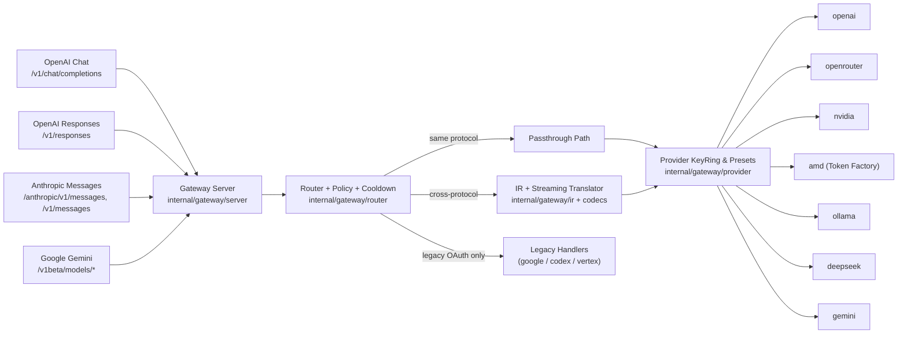
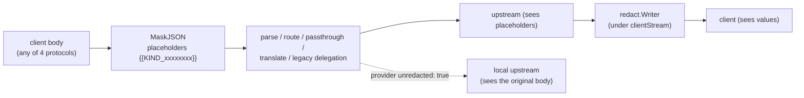

# Multi-Backend API Aggregation Gateway Design

## 1. Overview

`oauth-llm-nexus` now provides a Magpie-inspired 4x7 multi-protocol API aggregation gateway in `internal/gateway/` alongside existing legacy OAuth (`google`, `codex`, `vertex`) proxy flows. Any client speaking one of the **4 supported frontend protocols** can invoke models hosted on any of the **7 built-in API backends** (or custom YAML-configured backends) and switch backends at runtime without restarting clients.



## 2. Unified Frontend Protocols (`internal/gateway/codec*`)

| Frontend Protocol | Codec Package | Endpoints | Notes |
| :--- | :--- | :--- | :--- |
| **OpenAI Chat Completions** | `internal/gateway/codec/openaichat` | `POST /v1/chat/completions`, `GET /v1/models` | Supports `messages`, `tools`, `tool_calls`, `reasoning_content`, `<think>` tag extraction (`ThoughtTagParsing`), and `usage` |
| **OpenAI Responses API** | `internal/gateway/codec/openairesp` | `POST /v1/responses` | Translates `input`, `instructions`, `function_call`/`function_call_output`, `reasoning.effort`; native passthrough on `openai`, `deepseek`, `ollama`, `openrouter`, `amd` (see *Native Responses passthrough* below); `previous_response_id` is forwarded only to `responses_stateful` providers that issued it, otherwise expanded from the bounded TTL LRU `ResponseStore` (`internal/gateway/ir/respstore.go`) |
| **Anthropic Messages API** | `internal/gateway/codec/anthropic` | `POST /anthropic/v1/messages`, `POST /v1/messages`, `GET /anthropic/v1/models` | Supports `system`, `thinking` blocks (with signature cache `internal/gateway/ir/sigstore.go`), `tool_use`/`tool_result`, cache control usage |
| **Google Gemini API** | `internal/gateway/codec/gemini` | `GET /v1beta/models`, `GET /v1beta/models/{model}`, `POST /v1beta/models/{model}:generateContent`, `POST /v1beta/models/{model}:streamGenerateContent`, `POST /v1beta/openai/chat/completions` | Translates `contents`, `systemInstruction`, `functionDeclarations`/`functionCall`/`functionResponse`, `thinkingConfig` (`thinkingLevel` for Gemini 3 & 4), thought signatures; non-generation actions (`countTokens`, embeddings) forward through `KeyRing` with client `?key=` stripped before falling back to legacy |

### Unified Embeddings (`POST /v1/embeddings`, `POST /v1beta/openai/embeddings`)

OpenAI-compatible embeddings endpoint (`internal/gateway/server/embeddings.go`, `internal/gateway/router/embeddings.go`) sharing the same routing, key rotation, cooldown and pre-response failover as chat:

- **Resolution**: `X-Nexus-Provider` / `<provider>/<model>` prefix / DB `ModelRoute` aliases (e.g. `pkm-embed`) first; otherwise per-provider *embedding catalogs* (models detected by `IsEmbeddingModel` or Gemini `embedContent` support, kept apart from chat catalogs so they never pollute `/v1/models`). Vendor-namespaced IDs such as `nvidia/llama-3.2-nv-embedqa-1b-v1` are kept verbatim when the embedding catalog advertises them.
- **OpenAI-compatible backends** (`openai`, `nvidia`, `ollama`, `openrouter`, ...): passthrough to `{openai_chat}/embeddings` with the model rewritten.
- **Gemini backend**: translated to `:batchEmbedContents` (chunked at 100 inputs), `dimensions` → `outputDimensionality`, `encoding_format: base64` honored (little-endian float32, matching the OpenAI SDK default).
- **Retrieval hint**: optional `input_type` (alias `task_type`): `query` | `document`/`passage` | `similarity` | `classification` | `clustering`. Mapped to Gemini `taskType` (`RETRIEVAL_QUERY`/`RETRIEVAL_DOCUMENT`/...), forwarded as `query`/`passage` to backends with the `embedding_input_type` quirk (NVIDIA preset), stripped for strict OpenAI-compatible APIs.
- **Caveat**: vectors from different embedding models are not interchangeable. Only put the *same* model (served by different backends) into one failover alias, and pin the alias (`pinned`) once an index is built with it.

### Native Responses Passthrough (`openai_responses`)

Probed live on 2026-11-20: `openai`, `deepseek`, `ollama`, `openrouter` and `amd` serve `POST /v1/responses`;
`nvidia` and Gemini's OpenAI-compatible API do not (404) and keep translation. Their presets and
`config/providers.yaml` declare `openai_responses` and list `openai-responses` as native, so Responses clients are
passed through. Handling follows magpie's field-tested rules (`prev_response.go`):

- **State**: only providers marked `responses_stateful` (the `openai` preset; YAML `responses_stateful: true`)
  keep turns. Ollama and DeepSeek accept `previous_response_id` but silently drop the context; OpenRouter refuses
  it. A continuation is forwarded with its id only to a stateful provider that issued that response
  (`ResponseStore.Maker`); any other is expanded from `ResponseStore` into full input and sent without the id
  (`X-Nexus-Route: translated:openai-responses`). An id the gateway never saw is refused (400) on a stateless
  backend and the next candidate is tried.
- **History**: a passthrough turn is stored with the whole conversation (`saveResponsesTurn`), not only the new
  input a `previous_response_id` request carried, so a later failover keeps every turn.
- **Shape refusals**: a stateless backend's 400/404/422 about an item type or field it lacks (`isShapeRefusal`)
  retries the same backend through Chat translation and is remembered per provider/model (`respRefused`).
- **Image detail**: `input_image.detail: "original"` goes as `"high"` except to OpenAI and DeepSeek.
- `NEXUS_<ID>_BASE_URL` moves the Responses endpoint together with the Chat one.
- Live check: `scripts/smoke/responses_smoke.py` (single turn, continuation that must keep context, stream, tool loop).

### Translation Strategy (`ir.Request` + Stream-First)

1. **Same-Protocol Passthrough**: When the chosen backend natively supports the incoming client protocol (`Provider.TargetFor(clientProto)` returns `passthrough == true`), only the model field (`RewriteModelJSON`) and auth/base headers are rewritten while preserving vendor extensions verbatim (including OpenAI Responses `previous_response_id`).
2. **Cross-Protocol Translation**: Incoming requests parse into canonical IR (`internal/gateway/ir`), normalize reasoning effort (`internal/gateway/ir/effort.go`) and cached thinking signatures (`SigStore`), encode into the upstream codec (always opening an SSE stream upstream via `internal/gateway/sse`), decode upstream chunks back into `ir.StreamEvent`, and either re-encode as client SSE events or aggregate into a complete non-streaming response via `ir.Collector`.

## 3. Supported Backends & Configuration (`config/providers.yaml`)

7 built-in presets are defined in `internal/gateway/provider/presets.go` and loaded by `internal/gateway/provider/config.go` (`config/providers.yaml`, plus fallback compatibility with `config/openai_compat_providers.yaml`):

| ID | Preset | Default Base URL(s) | Native Protocols | Auth Env Vars | Notes |
| :--- | :--- | :--- | :--- | :--- | :--- |
| `openai` | OpenAI | `https://api.openai.com/v1` | `openai-chat`, `openai-responses` | `NEXUS_OPENAI_API_KEY` / `NEXUS_OPENAI_API_KEYS` | `MaxCompletionTokens` + stream usage |
| `openrouter` | OpenRouter | Chat: `https://openrouter.ai/api/v1`, Anthropic: `https://openrouter.ai/api` | `openai-chat`, `anthropic` | `NEXUS_OPENROUTER_API_KEY` / `NEXUS_OPENROUTER_API_KEYS` | `ThoughtTagParsing` quirk |
| `nvidia` | NVIDIA NIM | `https://integrate.api.nvidia.com/v1` | `openai-chat` | `NEXUS_NVIDIA_API_KEY` / `NEXUS_NVIDIA_API_KEYS` / `NVIDIA_API_KEY` | `StreamFirst`, `OmitStrictTools`, `ThoughtTagParsing` |
| `amd` | AMD Radeon Token Factory | Chat: `https://developer.amd.com.cn/radeon/api/v1`, Anthropic: `https://developer.amd.com.cn/radeon/api` | `openai-chat`, `anthropic` | `NEXUS_AMD_API_KEY` / `NEXUS_AMD_API_KEYS` / `AMD_API_KEY` | Nested `detail.error` parsing, `OmitStrictTools`, `ThoughtTagParsing` |
| `ollama` | Ollama Local | Chat: `http://localhost:11434/v1`, Anthropic: `http://localhost:11434` | `openai-chat`, `anthropic` | None (`no_key: true`) | 300s default timeout; override URL via `NEXUS_OLLAMA_BASE_URL` or `OLLAMA_BASE_URL` |
| `deepseek` | DeepSeek API | Chat: `https://api.deepseek.com/v1`, Anthropic: `https://api.deepseek.com/anthropic` | `openai-chat`, `anthropic` | `NEXUS_DEEPSEEK_API_KEY` / `NEXUS_DEEPSEEK_API_KEYS` / `DEEPSEEK_API_KEY` | `EchoReasoningContent`, `OmitReasoningEffort` |
| `gemini` | Google Gemini API | `https://generativelanguage.googleapis.com/v1beta` | `gemini` | `NEXUS_GEMINI_API_KEY` / `NEXUS_GEMINI_API_KEYS` / `GEMINI_API_KEY` | `x-goog-api-key` header |

Additional per-provider env overrides:
- `NEXUS_<ID>_ENABLED=true|false`
- `NEXUS_<ID>_BASE_URL` (or standard `<ID>_BASE_URL`, automatically normalizing `/v1` for OpenAI Chat and root URL for Anthropic)
- `NEXUS_<ID>_ANTHROPIC_BASE_URL`, `NEXUS_<ID>_RESPONSES_BASE_URL`, `NEXUS_<ID>_GEMINI_BASE_URL`
- `NEXUS_<ID>_API_KEY`, `NEXUS_<ID>_API_KEYS`, `<ID>_API_KEYS` (e.g. `GEMINI_API_KEYS`), or standard `<ID>_API_KEY` (`OPENAI_API_KEY`, `OPENROUTER_API_KEY`, `NVIDIA_API_KEY`, `AMD_API_KEY`, `DEEPSEEK_API_KEY`, `GEMINI_API_KEY`)
- `NEXUS_<ID>_KEY_STRATEGY=round-robin|sticky` (`gemini` preset defaults to `round-robin`)
- `NEXUS_<ID>_INCLUDE_NON_CHAT=true|false`
- `NEXUS_<ID>_TIMEOUT` (e.g. `120s`)
- `NEXUS_PROVIDERS_FILE` (override path to `providers.yaml`)
- `NEXUS_CORS_ORIGINS` (opt-in CORS for inference APIs `/v1/*`, `/v1beta/*`, `/anthropic/*`; comma-separated origins, `scheme://host:*` port wildcards and `*` supported, e.g. `http://localhost:*,tauri://localhost`). Admin `/api/*` and `/ui` stay same-origin.

### Request Transforms (`extra_body`, `system_prompts`)

Declarative per-provider edits of the outgoing inference body (`internal/gateway/codec/transform.go`, applied in `executePlan` right after `buildUpstreamPayload`, so both passthrough and translated attempts get them, in the target protocol). Embeddings, rerank and the admin test ping are untouched.

```yaml
  - id: openrouter
    preset: openrouter
    extra_body:                       # top-level fields; a field the body already has is kept…
      provider: {order: [anthropic, openai], allow_fallbacks: false}
      prompt_cache_key: pkm
      "!usage": {include: true}       # …unless written "!name": then it replaces the body's own
    system_prompts:                   # keyed by upstream model; * matches any run (incl. "/")
      "*": "Answer concisely."
      "anthropic/claude-*": "Use British spelling."   # most specific pattern wins
```

- **extra_body** merges at the top level, byte-preserving: untouched fields keep their exact bytes (prompt-cache prefixes stay stable), new fields are appended in name order. Reserved names (`model`, `stream`, `messages`, `input`, `contents`, `system`, `systemInstruction`, `system_instruction`, `instructions`, `tools`) are dropped with a log line when read from YAML and rejected with `400` by the admin API.
- **system_prompts** appends text to the system prompt: a new `system` message after the leading system/developer messages (OpenAI Chat), `system` string joined with a blank line or a new text block after existing (cache-marked) blocks (Anthropic), `instructions` joined (Responses), a new `systemInstruction.parts` entry (Gemini).
- Both run **after** privacy masking, so operator-configured text is never masked.
- **Runtime overrides**: `PATCH /api/gateway/providers/{id}` accepts `extra_body` (object; `null` or `{}` clears), `system_prompts` (map; `null` clears) and `unredacted` (bool). They are validated, applied live, persisted in `gateway_provider_overrides`, and replayed at startup over `providers.yaml` (`DELETE …/overrides` forgets them). `GET /api/gateway/providers` shows the effective values.

## 4. Routing Precedence, Failover, Key Rotation & Cooldown

### Resolution Order (`internal/gateway/router/router.go`)

1. **`X-Nexus-Provider` request header**: Forces execution against the named gateway provider (or legacy OAuth handler) with failover disabled (`Plan.Forced = true`).
2. **`<provider>/<model>` prefix (`shouldTreatAsProviderPrefix`)**: When the prefix before the first `/` matches a configured gateway or legacy provider ID, checks whether the full unstripped `<prefix>/<rest>` string is an explicit DB `ModelRoute` or a vendor-namespaced catalog model ID (such as `nvidia/nemotron-3.5-super-vl-120b-a12b` on `nvidia`, `nvidia/nemotron-3.5-super-vl:free` on `openrouter`, or `google/gemma-4-31b-it` on `nvidia`/`openrouter`). Only genuine provider prefixes (such as `amd/Gemma-4-31B-IT` or `openrouter/nvidia/nemotron-3.5-super-vl:free`) are stripped and pinned.
3. **Database `ModelRoute` + `ModelPolicy`**: Looks up active `ModelRoute` entries ordered by `(priority ASC, id ASC)` plus `ModelPolicy.Strategy` (`"failover"` default, or `"pinned"`).
   - `pinned`: Attempts only the primary route candidate (no automatic failover to secondary providers).
   - `failover`: Orders healthy non-cooled candidates first, placing candidates in cooldown after healthy ones so traffic fails over immediately when keys/rates degrade.
4. **Catalog Discovery (`HasExactModel` + `CanonicalModelID` Fallback)**: If no explicit DB `ModelRoute` exists (or only inactive legacy OAuth routes exist in failover mode), checks `internal/gateway/provider/catalog.go` (pre-warmed in background at startup, singleflight-deduplicated per provider) first for exact model ID matches, and when none match verbatim, falls back to canonical matches via `CanonicalModelID` (e.g., `deepseek-r1` matching `deepseek-reasoner`, `DeepSeek-R1`, `deepseek/deepseek-r1:free`).
   - **OpenRouter Free-Only Filtering**: By default (`free_only: true` in `openrouter` preset & `config/providers.yaml`), OpenRouter catalog discovery retains only zero-cost text models (e.g. `openrouter/free` and models with `0` prompt/completion/request/reasoning pricing and `"text"` output modality). Toggle at runtime via `PATCH /api/gateway/providers/openrouter`, `/ui`, or `NEXUS_OPENROUTER_FREE_ONLY=false` (explicit `ModelRoute` entries and `openrouter/<model>` prefixes continue to work regardless).
5. **Legacy OAuth Fallback**: If no gateway candidate applies and active legacy OAuth accounts exist (`Router.IsLegacyAvailable`), delegates to `google`, `codex`, or `vertex`.

### Key Rotation & Failure Handling

- **`KeyRing` (`internal/gateway/provider/keys.go`)**: Supports both `sticky` and `round-robin` (`key_strategy`, default `round-robin` for multi-key `gemini`, configurable via `NEXUS_<ID>_KEY_STRATEGY` and runtime PATCH), ingesting deduplicated keys across `NEXUS_<ID>_API_KEYS`, `<ID>_API_KEYS` (e.g., `GEMINI_API_KEYS`), `NEXUS_<ID>_API_KEY`, and `<ID>_API_KEY`. Tracks per-key health/telemetry (`StatusSnapshot`) and cooldown windows so exhausted/overloaded/invalid keys (`401`/`402`/`403`/`429`/`503`/`529` and Google `400 API_KEY_INVALID`) immediately relay to healthy siblings. Inspects `Retry-After` / `x-ratelimit-reset-*` and proactively rotates (`MarkExhaustedAndRotate`) when `x-ratelimit-remaining-requests: 0` is returned alongside HTTP 200.
- **`Cooldown` (`internal/gateway/router/cooldown.go`) & `ClassifyGatewayError` (`internal/gateway/router/classify.go`)**: Parses explicit reset headers (`ParseRateLimitHeaders`) to apply exact backoff windows (`MarkFailureWithRetry`) and classifies non-client errors (`402`, `503`/`529` short overload cooldown, `410` without backend poisoning, `408`/`5xx`) into cooldown only after all healthy keys fail before stream commitment. Client cancellations (`499`) never trigger backend cooldown, and pre-commit JSON error probing catches HTTP-200 non-SSE error payloads across both passthrough and translated streams.

### Stateful History, Model Guards & Always-On Telemetry

- **`CanonicalModelID` (`internal/gateway/provider/normalize.go`)**: Normalizes vendor namespaces (`deepseek/`, `deepseek-ai/`, `google/`, `meta-llama/`, etc.), routing suffixes (`:free`, `:latest`), casing, and known aliases (`deepseek-reasoner` → `deepseek-r1`) so `/api/gateway/models/matrix` and fallback catalog routing map one logical model cleanly across all supporting backends.
- **`ResponseStore` (`internal/gateway/ir/respstore.go`)**: Bounded TTL LRU (`2048` entries, `2h` TTL) caching OpenAI Responses API conversation turns so multi-turn `previous_response_id` flows work seamlessly when routed or failed over to non-OpenAI translated backends (`deepseek`, `amd`, `openrouter`, `ollama`, `gemini`).
- **Model Capability Filtering & Quirks**: `IsChatCapableModel` excludes non-chat models (e.g., `Clef`, `d3-flash`, `tts-*`, `*-embed*`, `nemoretriever`) from catalog discovery by default unless `include_non_chat: true` (`NEXUS_<ID>_INCLUDE_NON_CHAT=true`); `IsStrictReasoningModel` strips unsupported `temperature`/`top_p` sampling parameters on reasoning models (`o1`/`o3`/`o4`/`gpt-5*`) across both passthrough and translated paths; Gemini `buildThinkingConfig` emits `thinkingLevel` for both Gemini 3 and Gemini 4 (`carbon` / `hydrogen` / `argon`) models.
- **Always-On Metrics (`internal/gateway/server/metrics.go`)**: Accumulates per-provider and per-model requests, errors, average + EWMA latency, and tokens (`input`, `output`, `cached`, `reasoning`) even when full payload logging is disabled, extracting trailing usage chunks from streaming passthrough responses (`>512KB` safe 128KB rolling tail capture).

### Response Provenance Headers

Every gateway response includes diagnostic headers identifying the resolved execution path:
- `X-Nexus-Provider`: Backend provider ID selected (e.g., `openrouter`, `nvidia`, `amd`)
- `X-Nexus-Upstream-Model`: Exact target model ID sent upstream
- `X-Nexus-Route`: `"passthrough"`, `"translated:<target_protocol>"`, or `"legacy-oauth"`
- `X-Nexus-Route-Source`: `"header"`, `"prefix"`, `"db"`, `"catalog"`, or `"legacy-default"`

## 5. Runtime Switching Admin API & Dashboard

The `/api/gateway/*` endpoints (protected by `NEXUS_ADMIN_PASSWORD` when set) expose live state and instant runtime backend switching without client restarts:

| Method & Path | Purpose |
| :--- | :--- |
| `GET /api/gateway/providers` | List all gateway providers, per-key `key_statuses`, `key_strategy`, protocol capabilities, active cooldowns, live `stats`, and catalog counts |
| `PATCH /api/gateway/providers/{id}` | Mutate runtime provider settings (`enabled`, `free_only`, `include_non_chat`, `prefer`, `key_strategy`), add/remove API keys (`add_api_key`, `remove_api_key`), clear cooldowns, and refresh catalog. Changes are persisted to SQLite (`configs.gateway_provider_overrides`) and replayed at startup, taking precedence over `providers.yaml`/env; UI-added keys are stored verbatim in the local DB, removed env keys only as SHA-256 fingerprints |
| `DELETE /api/gateway/providers/{id}/overrides` | Forget persisted runtime overrides for `{id}` (config/env defaults apply after restart) |
| `POST /api/gateway/providers/{id}/refresh` | Refresh live upstream model catalog for provider `{id}` |
| `GET /api/gateway/stats` / `POST /api/gateway/stats/reset` | Read or reset lightweight always-on per-provider, per-model & per-client-key (`keys`) request/latency/token counters |
| `GET /api/gateway/models` | List unified models with active backend, exact + canonical candidates, and `failover`/`pinned` policy |
| `GET /api/gateway/models/matrix` | Inverted model-to-backends matrix grouped by `CanonicalModelID` (filterable by `?q=` and `?multi_only=true`) |
| `GET /api/gateway/models/{client}` | Inspect all supporting candidates (DB routes + canonical catalog matches) for a single model |
| `POST /api/gateway/select` / `POST /api/gateway/models/{client}/select` | Promote/upsert candidate backend to `priority = 1` at runtime (and optionally clear its cooldown) |
| `POST /api/gateway/models/{client}/failover` | Materialize all discovered supporting backends for `{client}` into priority-ordered failover DB routes |
| `PUT /api/gateway/policy` / `PUT /api/gateway/models/{client}/policy` | Set per-model strategy: `"failover"`, `"pinned"`, `"rotate"`, `"usage"` (least used) or `"fastest"` |
| `POST /api/gateway/cooldown/clear` | Clear cooldowns (provider-level and per-key) for one provider or all providers |
| `POST /api/gateway/test` | Execute a live protocol compatibility probe (`openai-chat`, `openai-responses`, `anthropic`, `gemini`, supporting `stream` & `tools`) with optional pinned `provider` |
| `GET /api/gateway/usage` | Usage ledger summary (`from`, `to`, `group_by=provider\|model\|caller\|key\|day`, `caller`, `provider`) with costs; `?recent=N` lists raw records |
| `GET/PUT/DELETE /api/gateway/prices` | Model price overrides (USD per 1M tokens); `?provider=&model=` shows effective metadata |
| `GET/PUT/DELETE /api/gateway/caps` | Spend caps: `subject` = `caller:<key name>` or `key:<provider>#<fp>`, `period` day\|month, `usd`, `tokens` |
| `GET /api/gateway/keys` | List client keys (masked, never the secret) plus the read-only `legacy` key, with allowlists, `last_used_at`, and per-key `stats` |
| `POST /api/gateway/keys` | Issue a named client key; the plaintext `api_key` is returned **only in this response** |
| `PATCH /api/gateway/keys/{id}` | Update `allowed_providers`, `allowed_models` (`[]` clears = unrestricted; omitted = unchanged) or `disabled`; `{id}` is the numeric id or the name |
| `DELETE /api/gateway/keys/{id}` | Revoke a client key immediately |

### Client Keys & Caller Allowlists (`internal/auth/clientkey`)

Several callers (a personal knowledge-management app, coding agents, LAN devices) can each get their own gateway credential, so a privacy-sensitive caller can be confined to trusted backends (e.g. `pkm-app` → `ollama` + `gemini`, never free OpenRouter models).

- **Storage**: `client_keys` table (`models.ClientKey`, migrated by `db.InitDB`): `name` (unique, `[A-Za-z0-9][A-Za-z0-9._-]{0,63}`, `legacy` reserved), `key_hash` (hex SHA-256 — the plaintext is never stored), `key_hint` (masked display), `allowed_providers` / `allowed_models` (JSON arrays; empty = unrestricted), `disabled`, `created_at`, `last_used_at` (written at most once per minute per key). Keys look like `sk-nx-<48 hex>` (192 bits). Lookups are cached per DB handle and invalidated on every mutation.
- **Authentication** (`middleware.APIKeyAuth`): the same credential sources as before (`Authorization: Bearer`, `x-api-key`, `x-goog-api-key`, `?key=`). The legacy `configs.api_key` keeps working as the unrestricted `legacy` caller; client keys resolve by hash. Disabled keys get `401 "API key is disabled"`. Auth is skipped only when neither a legacy key nor any client key exists. The resolved `clientkey.Caller` travels in the request context.
- **Model allowlist**: checked against the client-facing `model` string before routing — exact (case-sensitive) or `prefix*`. `ollama/llama3` and `llama3` are different entries.
- **Provider allowlist**: applied to the resolved `router.Plan` in `handleInference` (all four protocols) and `HandleOpenAIEmbeddings` before any upstream is contacted. Disallowed gateway candidates are dropped (failover continues over the permitted ones); legacy OAuth delegation counts as provider `google` / `codex` / `vertex`, and a permitted legacy fallback is promoted when no gateway candidate remains. Explicit `X-Nexus-Provider` / `<provider>/<model>` selection cannot escape the allowlist. Gemini non-generation actions (`countTokens`, `embedContent`, `batchEmbedContents`) always count as provider `gemini`.
- **Denials** return `403` in the caller's protocol (`permission_error` for OpenAI/Anthropic, `PERMISSION_DENIED` for Gemini, code `forbidden_by_key_policy`) and are counted as errors in the key's stats.
- **Raw routes**: `/{provider}/*`, `/genai/*` (`google`), `/v1/publishers/google/models/*` (`vertex`) and `/v1/codex/quota` (`codex`) bypass model routing, so `middleware.RequireProvider` requires the served provider to be allowlisted and rejects keys that carry a model allowlist outright.
- **Limitation**: filtering happens after resolution, so a restricted caller does not trigger fall-through the router would otherwise skip (e.g. a DB alias that only targets disallowed providers returns `403` rather than falling back to catalog discovery on an allowed provider; with the `pinned` strategy only the pinned backend is considered). Add an explicit route for the allowed provider in that case. Model listings (`/v1/models`) are not filtered per key.
- **Admin access**: `/api/gateway/keys` sits behind `NEXUS_ADMIN_PASSWORD` like the rest of `/api`; set it whenever the gateway listens beyond loopback (`HOST=0.0.0.0`).

```bash
# Issue a key for the PKM app that may only reach local/trusted backends
curl -s -X POST localhost:8080/api/gateway/keys -H 'Content-Type: application/json' \
  -d '{"name":"pkm-app","allowed_providers":["ollama","gemini"],"allowed_models":["notes-*","kb-embed"]}'
# → 201 {"key":{"id":1,"name":"pkm-app","masked_key":"sk-nx-ab…9f3c",...},"api_key":"sk-nx-…","note":"store this key now; ..."}

curl -s -X PATCH localhost:8080/api/gateway/keys/pkm-app -d '{"allowed_models":[]}'   # clear model allowlist
curl -s -X PATCH localhost:8080/api/gateway/keys/1 -d '{"disabled":true}'            # suspend
curl -s -X DELETE localhost:8080/api/gateway/keys/pkm-app                           # revoke
```

The standalone Magpie-inspired console at **`GET /ui`** (`internal/ui/`) consumes these endpoints alongside `/api/model-routes`, `/api/config/apikey`, and `/api/request-logs` to provide:
- Split-pane **Providers & Catalog** inspection with per-key health pills, `round-robin` / `sticky` key relay switch, live `Enabled` / `Free Only` / `Include Non-Chat` switches, preferred protocol selector, inline `+ Add` / `×` key management, real-time telemetry tiles, and inline model probing
- **Routing & Model Matrix** with dedicated `Model Matrix` tab listing all supporting backends per canonical model (`TargetModel`, native protocols, EWMA latency), one-click primary switching, and `⚡ Sync Failover Group`
- **4-Protocol Compatibility Tester** (`OpenAI Chat Completions`, `OpenAI Responses`, `Anthropic Messages`, and `Google Gemini`) across `Sync JSON`, `Stream SSE`, and `Tool Call` modes with full wire request/response inspection
- **Connect & Activity** with copyable `Shell` / `curl` / `Python SDK` snippets (including `@google/genai` & Gemini CLI) and expandable recent request logs
- **Client Keys** panel (Connect view, backed by `/api/gateway/keys`): issue keys with provider toggle pills and model aliases, one-time plaintext reveal with "use in snippets", inline allowlist editing, enable/disable, delete, and per-key request/error/token counters

The legacy Dashboard at `/` (`internal/proxy/handlers/dashboard.go`) remains intact for existing OAuth account workflows.

## 6. Privacy Masking (`internal/gateway/redact`)

Rule-based masking of secrets and personal data before a request leaves the gateway, with the values put back in the reply on its way to the client. Off by default. The design follows magpie's field-tested `internal/redact` (rule set, byte-preserving JSON walk, split-placeholder streaming restore) without its plugin runtime or local-model finders.



- **Switch**: persisted setting `enabled` (`PUT /api/gateway/masking`) wins; otherwise `NEXUS_MASKING=on`. When masking is on and cannot run (key unreadable, a panic in a rule) the request fails closed with `503 masking_unavailable` — nothing is sent.
- **Kinds** (`redact.Kinds`): `PRIVATE_KEY` (PEM blocks), `API_KEY` (`sk-`/`sk-ant-`/`sk-proj-`…, `ghp_`/`gho_`/`github_pat_`/`glpat-`, `AIza…`, `xox?-`, `AKIA`/`ASIA`, `hf_`, `gsk_`, `xai-`, `sk_live_`), `TOKEN` (JWTs), `PASSWORD` (`scheme://user:pw@`), `SECRET` (secret-named assignments such as `DB_PASSWORD=…`, `"client_secret": "…"`, `*_KEY=`, and `Authorization:` / `Cookie:` values), `EMAIL` (real TLDs only: a curated generic list plus two-letter ccTLDs, excluding file-like endings and `example.*`/`.test`/`noreply`/`git@`), `BANK_CARD` (15–19 digits passing Luhn), `ID_CARD` (PRC resident ID with mod-11 check digit). Values that look like variables (`${X}`, `<token>`, `****`), code (`token: getToken()`), versions and timestamps are left alone.
- **Placeholders**: `{{KIND_xxxxxxxx}}`, `xxxxxxxx` = lowercase base32 of `HMAC-SHA256(key, kind+"\x00"+value)[:8]`. The 32-byte key is created once as `nexus.redact.key` (mode `0600`) next to `nexus.db`; deterministic placeholders keep conversation prefixes byte-identical across turns and restarts, so prompt caches keep hitting. Placeholder→value pairs live in an in-memory LRU (100k entries).
- **What is masked** (client-protocol JSON, before parse and passthrough): message text, system prompts, tool results, tool-call arguments (JSON-text `arguments` are walked as JSON so restored values stay correctly escaped; inside arguments a field named for a secret, e.g. `api_key`, is masked whole). **Skipped**: `id`, `*_id`/`*Id`, `name`, `type`, `role`, `model`, `url`, `media_type`, `signature`, `encrypted_content`, `data`, `data:` URIs; in tool and schema definitions (`tools`, `tool_choice`, `response_format`, Responses `text`, `generationConfig`, …) only `description` is masked. Blocks a vendor signed (thinking with a signature, Gemini thought-signature parts, encrypted reasoning) are left as written except that values masked before get their placeholders back, so the signed text matches again.
- **Restore**: non-stream JSON is restored string by string at the end (`arguments`/`partial_json`/argument deltas JSON-escaped). SSE is restored event by event: an event whose text ends in a possible placeholder start (`{{EMA`, `EMAIL_b5pu`) is held per event context (`event`, `type`, `item_id`, `index`s) and JSON path until the next event of the same context completes it; keepalive comments and wait events (`ping`, Responses keepalive) pass a held event; `[DONE]` and stream end release it. Model-mangled placeholders (`{{ EMAIL_x }}`, missing braces, changed case) are restored too.
- **Modes per kind**: `mask` (default), `warn` (sent as written, logged with kind and length only), `block` (`403 sensitive_content_blocked` naming the kinds, nothing sent), `off`. **Allowlist** `allow`: exact values (case-insensitive) or `@domain` for addresses at a domain and its subdomains.
- **Per-provider `unredacted`** (YAML, PATCH, default `true` for the `ollama` preset): such a candidate gets the original body (parsed lazily); its Responses turns are kept out of the shared `ResponseStore` so a later turn cannot replay them unmasked to a cloud backend.
- **Embeddings** are not masked unless `mask_embeddings: true` (a placeholder embeds differently from its text).
- **Logs**: the request monitor stores the masked request body, so secrets are not written to `nexus.db`. Responses carry `X-Nexus-Masked: <n>` when values were masked.
- **Not covered**: raw provider routes (`/{provider}/*`, `/genai/*`, Vertex publisher), Gemini non-generation actions (`countTokens`, `embedContent`), rerank, and the admin test ping.

```bash
curl -s -X PUT localhost:8080/api/gateway/masking -H 'Content-Type: application/json' \
  -d '{"enabled":true,"modes":{"EMAIL":"warn","PRIVATE_KEY":"block"},"allow":["@mycorp.com"]}'
curl -s localhost:8080/api/gateway/masking            # settings, source (setting|env|default), per-kind counters
curl -s -X POST localhost:8080/api/gateway/masking/preview -d '{"text":"key sk-ant-…"}'   # dry run: masked text + hits
```
