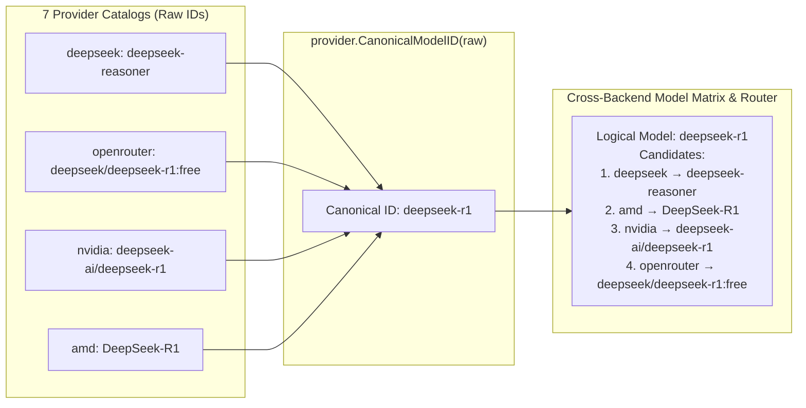

# Optimization Plan: First-Class Gemini Protocol, Model-to-Backends Matrix & Multi-Key Relay (`GEMINI_API_KEYS`)

> **Status: Implemented** (verified with `node -c`, `go build ./...`, `go vet ./...`, and `go test -count=1 -race ./...`).

## 1. Executive Summary

Based on live testing feedback on `http://localhost:8080/ui` (e.g., testing `gemini-4-hydrogen` across protocols) and a comparison with Magpie's architecture, this proposal addresses three core capabilities required to unify backend API management for diverse frontend agents (Claude Code, Codex CLI, Antigravity / Gemini CLI, OpenAI/Anthropic/GenAI SDKs):

1. **First-Class Google Gemini API Protocol Support (4-Protocol Parity)**: Elevate Google Gemini API (`/v1beta/models/*`) from an optional "3+1" protocol to a co-equal 4th pillar alongside OpenAI Chat, OpenAI Responses, and Anthropic Messages—with full `gemini-4-*` (Carbon / Hydrogen / Argon) thinking support, `/v1beta/openai/chat/completions` compatibility, query-key sanitization, and 4-protocol UI testing.
2. **Model-Centric Backend Discovery ("Given a Model, List All Supporting Backends")**: Introduce canonical model normalization (`CanonicalModelID`) and an inverted cross-provider matrix (`GET /api/gateway/models/matrix` + UI Matrix View) so variations like `deepseek-r1`, `deepseek/deepseek-r1:free`, `deepseek-ai/deepseek-r1`, and `deepseek-reasoner` are grouped under one logical model with one-click primary switching and failover group construction.
3. **Enhanced `GEMINI_API_KEYS` Multi-Key Relay & Concurrency Spreading**: Fix missing `<ID>_API_KEYS` (`GEMINI_API_KEYS`) environment variable loading, handle Google-specific `400 API_KEY_INVALID` and `503 high demand` errors in key rotation, support `round-robin` vs. `sticky` key relay modes to avoid parallel request bursts hitting a single key, and surface per-key health/cooldown status in `/ui`.

---

## 2. Evaluation & Design Details

### 2.1 Google Gemini API Protocol: Worth Introducing as First-Class?

**Assessment: Strongly Yes.**
With Google's Gemini 3 and Gemini 4 (Carbon / Hydrogen / Argon) model families and Gemini-native agent tools (Antigravity, Gemini CLI, `@google/genai` SDK), speaking native `/v1beta/models/{model}:generateContent` and `:streamGenerateContent` avoids lossy translation when either the frontend agent or the upstream backend is Gemini-native:

- **Native-to-Native Passthrough**: Preserves Google-specific features (`thoughtSignature`, `thinkingConfig.thinkingLevel`, `groundingMetadata` / Google Search tools, `inlineData` / `fileData` multimodal parts, `cachedContent`, and `countTokens`).
- **Any-Agent-to-Gemini & Gemini-Agent-to-Any-Backend**: Through our IR codec (`internal/gateway/codec/gemini/`), an Antigravity / Gemini CLI client can also be routed to DeepSeek, AMD, NVIDIA, OpenRouter, or OpenAI seamlessly.

#### Identified Gaps in Current Implementation & Fixes

| # | Current Gap | Location | Proposed Fix |
| :--- | :--- | :--- | :--- |
| **G1** | `buildThinkingConfig` only checks `strings.Contains(lowerModel, "gemini-3")` for `thinkingLevel` (`MINIMAL`/`LOW`/`MEDIUM`/`HIGH`), causing `gemini-4-*` (`gemini-4-hydrogen`, `gemini-4-argon`, `gemini-4-carbon`) to fall back to legacy `thinkingBudget`. | `internal/gateway/codec/gemini/build.go:144` | Match `gemini-3`, `gemini-4`, and `carbon`/`hydrogen`/`argon` model families for `thinkingLevel` config. |
| **G2** | `/ui` Protocol Tester treats Gemini as `optional: true` ("三协议兼容性测试台"), hiding the Gemini card by default and excluding it from "Test All". | `internal/ui/assets/app.js:148-153` | Upgrade to a **4-Protocol Compatibility Tester** (`OpenAI Chat`, `OpenAI Responses`, `Anthropic Messages`, `Google Gemini`) with 2×2 or 4-column responsive cards and Gemini SDK snippets in `Connect`. |
| **G3** | Client `?key=<nexus-key>` query parameter used by Google GenAI SDKs is authenticated by `APIKeyAuth`, but `forwardGeminiProviderAction` copies raw `r.URL.RawQuery` upstream—leaking `<nexus-key>` to `generativelanguage.googleapis.com` where Google rejects it. | `internal/gateway/server/server.go:121-123` | Strip `key` from forwarded upstream query parameters (`sanitizeUpstreamQuery`) and wrap non-generation actions (`:countTokens`, `:embedContent`) in `KeyRing` retry/rotation. |
| **G4** | `/v1beta/openai/chat/completions` (supported by legacy `geminikey`) is not mounted under `/v1beta` in the new gateway router. | `cmd/nexus/main.go:343-348` | Mount `r.Post("/openai/chat/completions", gatewayServer.HandleOpenAIChat)` inside `/v1beta`. |

---

### 2.2 "Given a Model, List All Supporting Backends" (Magpie Model Matrix)

#### Why Current Discovery Falls Short
Currently, `buildModelViewWithData` in `internal/gateway/server/admin.go:386-391` only links catalog models across providers when `m.ID == client` (exact string equality). In practice, the 7 backends name the same model differently:

- `deepseek`: `deepseek-chat`, `deepseek-reasoner`
- `openrouter`: `deepseek/deepseek-chat:free`, `deepseek/deepseek-r1:free`, `google/gemini-2.5-flash:free`
- `nvidia`: `deepseek-ai/deepseek-v3.2`, `deepseek-ai/deepseek-r1`, `deepseek-ai/deepseek-v4.1-flash`
- `amd`: `DeepSeek-V4-Flash`, `DeepSeek-V4.1-Flash`, `DeepSeek-R1`
- `gemini`: `gemini-2.5-flash`, `gemini-4-hydrogen`

Because the raw IDs differ by vendor prefix, case, or `:free` suffix, each appears as an isolated single-provider model rather than a unified model with multiple candidate backends.

#### Proposed Solution: Canonical Model Normalization & Cross-Backend Matrix

1. **`provider.CanonicalModelID(rawID string) string` (`internal/gateway/provider/normalize.go`)**:
   - Lowercase and trim whitespace.
   - Strip known vendor/namespace prefixes (`deepseek/`, `deepseek-ai/`, `google/`, `meta-llama/`, `meta/`, `qwen/`, `mistralai/`, `anthropic/`, `openai/`, `nvidia/`, `microsoft/`).
   - Strip routing/tier suffixes (`:free`, `:latest`, `:exacto`, `:nitro`).
   - Normalize well-known official aliases (e.g., `deepseek-reasoner` ↔ `deepseek-r1`, `deepseek-chat` ↔ `deepseek-v3`).
2. **Router Enhancement (`internal/gateway/router/router.go`)**:
   - In `resolveCatalogCandidates`, match exact `m.ID == clientModel` first (priority tier 1), followed by canonical matches `CanonicalModelID(m.ID) == CanonicalModelID(clientModel)` (priority tier 2), automatically setting `cand.UpstreamModel = m.ID`!
   - Result: Calling Nexus with `"model": "deepseek-r1"` or `"model": "deepseek-v4.1-flash"` automatically discovers all supporting backends and fails over across them using each backend's exact native model ID.
3. **Admin API & `/ui` Model-to-Backends Matrix**:
   - Group models by canonical ID in `GET /api/gateway/models` (exposing `canonical_id` and all matched `candidates` with their respective `provider` + `target_model` + `free_only` + `latency_ewma_ms` + `available`).
   - In `/ui` (`路由映射` & `后端与模型`):
     - Show a **"多后端可用 (N Backends)"** filter and badge on every model supported by ≥2 providers.
     - Clicking any model displays all supporting backends side-by-side (`Provider` → `Upstream Model ID` → `Native Protocols` → `Latency / Status`), with one-click **"设为主用 (Use First)"**, **"一键生成多后端接力路由 (Sync Failover Group)"**, and **"多后端横测对比 (Benchmark All Backends)"**.

---

### 2.3 `GEMINI_API_KEYS` Multi-Key Relay & Rate-Limit Resilience

#### Root Cause Analysis of Current Issues
1. **`GEMINI_API_KEYS` (without `NEXUS_` prefix) is ignored**:
   - `internal/gateway/provider/config.go:377-387` checks `NEXUS_<ID>_API_KEY`, `NEXUS_<ID>_API_KEYS`, and `<ID>_API_KEY`, but **omits `<ID>_API_KEYS`** (e.g., `GEMINI_API_KEYS`, `OPENAI_API_KEYS`). Moreover, if both `GEMINI_API_KEY` and `GEMINI_API_KEYS` are set in `/opt/local/.env`, they should be merged and deduplicated rather than mutually exclusive.
2. **Why `Anthropic Messages API` hit `HTTP 503 ERR` in the screenshot**:
   - When clicking "一键测齐三大协议", the UI fires 3 parallel requests at the exact same instant.
   - `KeyRing.Current()` is sticky (`keys[idx]`), so all 3 concurrent requests use **Key #1**.
   - Google AI Studio throttles concurrent bursts on `gemini-4-hydrogen` with `HTTP 503 ("This model is currently experiencing high demand...")` or `HTTP 429`.
   - In `internal/gateway/router/classify.go:148`, `503` has `RotateKey: false`, so `attemptWithKeys` immediately returned `503` to the client instead of relaying to **Key #2** in `KeyRing`!
3. **Google AI Studio `400 API_KEY_INVALID` does not rotate keys**:
   - Unlike OpenAI/Anthropic (which return `401`/`403` for invalid keys), Google AI Studio returns `HTTP 400 INVALID_ARGUMENT` with `"API key not valid"` / `"API_KEY_INVALID"`. Because `400` defaults to `RotateKey: false`, one invalid/expired key in `GEMINI_API_KEYS` blocks subsequent keys.

#### Proposed Multi-Key Relay Architecture (`internal/gateway/provider/keys.go` & `router/classify.go`)

1. **Unified Multi-Key Env Loading (`config.go` & `geminikey/provider.go`)**:
   - Collect, strip quotes, split (by `,`, `;`, or newline), and deduplicate keys from all 4 sources in order:
     1. `NEXUS_<ID>_API_KEYS`
     2. `<ID>_API_KEYS` (e.g. `GEMINI_API_KEYS`)
     3. `NEXUS_<ID>_API_KEY`
     4. `<ID>_API_KEY` (e.g. `GEMINI_API_KEY`)
   - Automatically sync the `gemini` gateway provider's `KeyRing` with legacy `geminikey` so both `/v1beta/models/*` and translated protocols share the exact same key pool.

2. **Dual Key Selection Modes (`sticky` Relay vs. `round-robin` Pool)**:
   - **`round_robin` (Default when `KeyCount() > 1` on rate-limited providers like `gemini`, configurable via `key_strategy`)**: `NextKey()` atomically advances across healthy keys on each incoming request so concurrent bursts (like 4-protocol simultaneous testing or parallel subagents in Antigravity/Claude Code) spread across Key #1, Key #2, Key #3 automatically.
   - **Pre-Commit Failure Relay (`attemptWithKeys`)**: If the chosen key returns any rotatable error before stream bytes are committed, immediately mark that key in cooldown and retry with the next healthy key in the ring (up to `min(KeyCount(), 4)` attempts per provider).

3. **Google-Aware Failure Classification (`ClassifyUpstreamFailure`)**:
   - Rotate keys (`RotateKey: true`) on:
     - `401`, `402`, `403`, `429` (existing)
     - `503`, `529` (upstream overload / high demand: short 5s–15s key cooldown + immediate relay to next key; even when `forced == true` in single-provider testing, key rotation within the same provider still executes!)
     - `400` when upstream error code/message matches `API_KEY_INVALID`, `api_key_not_valid`, `key_expired`, or `billing_not_enabled` (quarantine the bad key for 1h and relay to next key).

4. **Per-Key Health & Telemetry in Admin API & `/ui`**:
   - Extend `KeyRing.StatusSnapshot()` to return per-key masked ID, `active` flag, `healthy` boolean, `cooling_remaining_sec`, `requests`, `errors`, and `last_status`.
   - In `/ui` -> `Providers` -> `Credentials`: display each masked key as a status pill (`🟢 ***...a1b2 (12 req)` / `🟡 ***...c3d4 (CD 14s · 429)` / `🔴 ***...e5f6 (Invalid)`) with a remove button (`×`) and `Sticky / Round-Robin` toggle.
